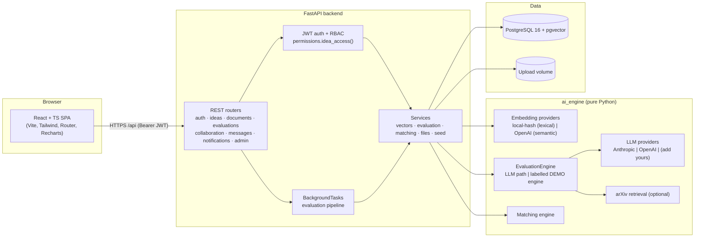
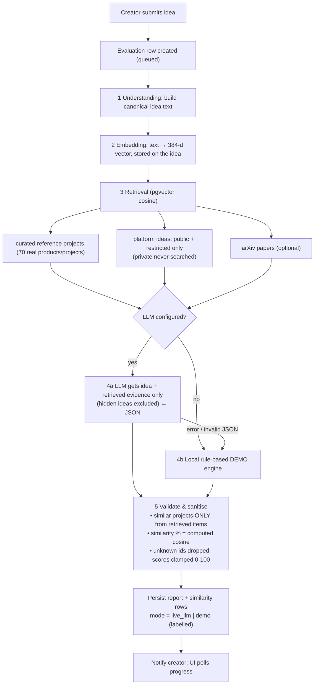
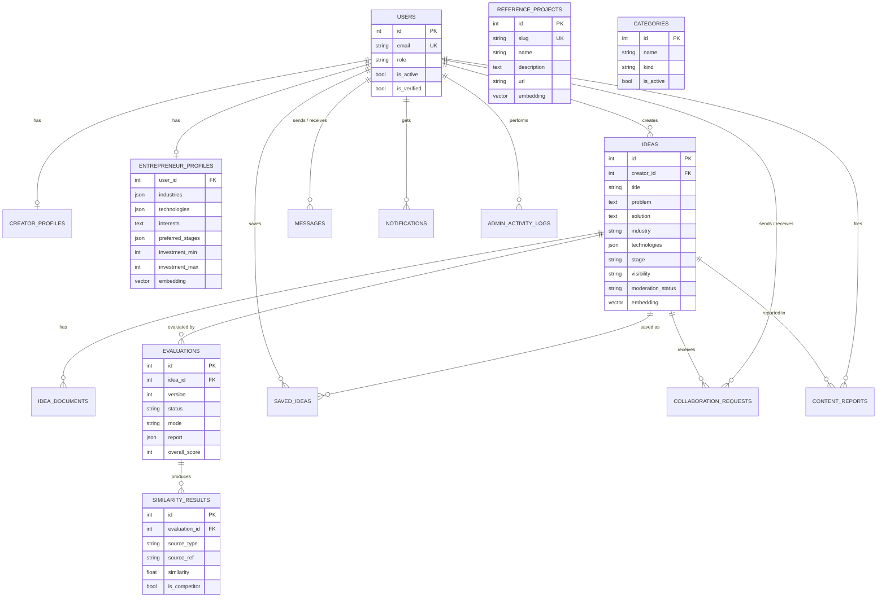

# IdeaBridge – Architecture

## 1. System architecture

* The frontend never sees API keys; all AI calls happen server-side.
* `ai_engine` has no web-framework dependency and is unit-tested on its own.
* Vector search runs inside PostgreSQL via pgvector (`<=>` cosine distance); on SQLite (dev/tests) an exact in-process cosine search with identical semantics is used.

## 2. AI evaluation workflow

## 3. Entity-relationship diagram

`REFERENCE_PROJECTS` (curated corpus) and `CATEGORIES` are standalone lookup tables.

## 4. Access control model

| Visibility | Anonymous | Other creators | Entrepreneurs | Owner / Admin |
|---|---|---|---|---|
| public | teaser + scores | full | full | full |
| restricted | hidden (404) | teaser | teaser → **full after an accepted request** | full |
| private | hidden (404) | hidden | hidden | full |

*Teaser* = title, short description, industry, technologies, stage. Documents, the evaluation report and long-form text require **full** access. Hidden/removed-by-moderation ideas behave as private. Forbidden resources return 404 rather than 403 so existence is not revealed. All rules live in `backend/app/permissions.py`.

## 5. Design decisions & limitations

* **Embeddings.** Default `local-hash` embeddings are *lexical* (hashed stemmed words/bigrams/char-trigrams). They measure shared vocabulary, not meaning, and are labelled as such in every report. Set `EMBEDDING_PROVIDER=openai` for semantic vectors (384 dims via the `dimensions` parameter). Switching models requires *Admin → Re-embed all content*.
* **Comparison corpus.** 70 curated real projects/products (`ai_engine/data/reference_projects.json`) + platform ideas + optional arXiv. It is not the whole market; reports say so.
* **Scoring.** In live mode the LLM proposes the three sub-scores; the overall score is computed in code (35/35/30 weighting). In demo mode all scores come from transparent heuristics (`ai_engine/demo_engine.py`).
* **Documents** are stored and access-controlled but not read by the AI.
* **Background jobs** use FastAPI `BackgroundTasks` (in-process). For production scale replace with a queue (Celery/RQ/Arq) – the pipeline entry point `run_evaluation(evaluation_id)` is already queue-friendly.
* **Search & matching at scale.** Explore filters on technology/semantic ranking and recommendations run in Python over at most 1000/300 candidate rows. Fine for thousands of ideas; move to SQL/pgvector queries beyond that.
* **Rate limiting** is limited to an in-memory login throttle; use a gateway or Redis-based limiter in production.
* **Token storage.** The SPA keeps the JWT in `localStorage` (simple, XSS-sensitive). For stricter deployments move to httpOnly cookies + CSRF protection.
